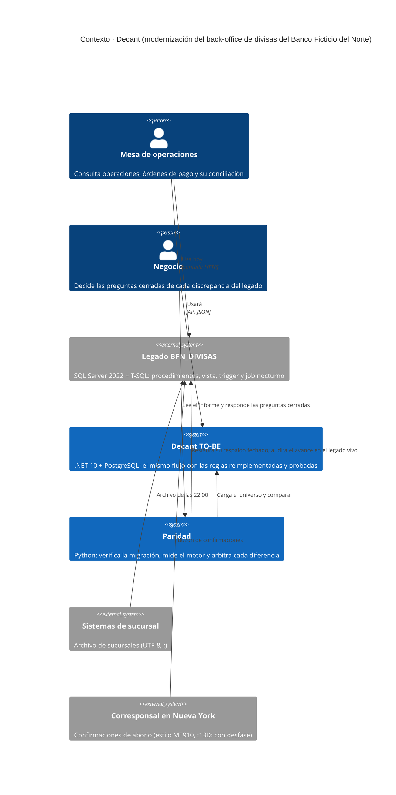
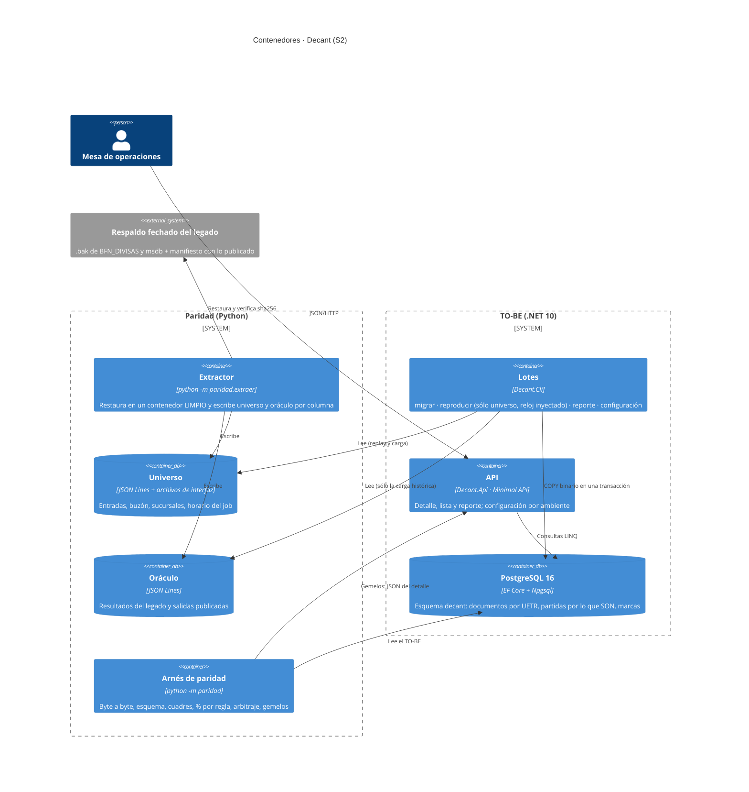

# Arquitectura · Decant

Modelo C4 en dos niveles: contexto y contenedores. Los diagramas son texto (Mermaid) y describen lo que hay en el
código de la semana 2, no un plan. Las decisiones están en [`docs/adr/`](../adr).

## 1. Contexto

## 2. Contenedores

## Capas del TO-BE (las hacen cumplir `tests/Decant.Architecture.Tests`)

| Proyecto | Depende de | Contiene |
|---|---|---|
| `Decant.Domain` | sólo la BCL | `OrdenDePago` (un documento por UETR), reglas de cambio, cargos, conciliación y vencimiento, lectura del MT910, `IClock`, `Resultado<T>`, invariante del reproceso |
| `Decant.Application` | Domain | casos de uso (carga histórica, replay, consultas, reproceso), puertos, mediador propio, banderas y destinos como records |
| `Decant.Infrastructure` | Application | EF Core + Npgsql (migraciones, consultas), almacén con COPY, lectores del universo y del oráculo, `SystemClock` |
| `Decant.Api`, `Decant.Cli` | Infrastructure | composición, presentación (cada hora en su zona) y configuración por ambiente |

## El flujo de S2 en una corrida

1. `./ciclo.sh` levanta el legado, lo carga, toma el respaldo fechado y aplica el delta del día (legado vivo).
2. `python -m paridad` restaura el respaldo en un contenedor limpio, mide el corte y extrae universo y oráculo.
3. `decant migrar` (carga histórica) y cuatro `decant reproducir`: hasta el corte con banderas encendidas, dos en
   «sólo marca» y uno con TODO el universo (el TO-BE en sombra).
4. El arnés verifica la migración, mide el motor, compara el reporte del TO-BE en sombra con el que el legado
   publicó, levanta la pantalla del legado y la API para los gemelos, y escribe `paridad/informe/paridad.md`.
